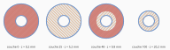

# Trancheur 3D

[](https://github.com/brakan1337/trancheur-3d/actions/workflows/ci.yml)

Un trancheur pour l'impression 3D : il lit une pièce au format STL, la découpe en couches, calcule les trajets de la buse (parois, peaux pleines, remplissage) et écrit le G-code que la machine exécute.

**C++20 · CMake · Clipper2 · multithreading · doctest · AddressSanitizer · GCC, Clang et MSVC**



*La bague épaulée de démonstration. Couche 0 : le dessous, plein. Couche 25 : remplissage croisé à 20 %. Couche 48 : juste sous l'épaulement, la couronne extérieure devient un dessus et passe en plein, tandis que le centre reste en remplissage. Couche 100 : la partie fine.*

## Le brief

> Ce projet est un cas d'étude. Le client est fictif ; le brief sert à justifier les choix techniques.

Un fabricant de cellules d'impression 3D robotisées pilote ses machines avec un logiciel écrit en C++. Il veut son propre module de tranchage, intégré à ce logiciel, plutôt qu'un outil externe dont il ne maîtrise ni les réglages ni les mises à jour. Ses pièces sortent de scanners et de logiciels de CAO avec plusieurs millions de triangles, et le découpage doit tenir en quelques secondes.

**Pourquoi C++ :**
- **Il s'intègre tel quel au logiciel de pilotage existant**, sans pont entre deux langages.
- **La géométrie de millions de triangles demande la vitesse du code natif :** mémoire contiguë, aucune pause de ramasse-miettes, et tous les cœurs de la machine.

## Ce que fait le trancheur

1. **Lecture du STL**, binaire ou texte, reconnu tout seul. Un STL répète chaque sommet dans chaque triangle : les sommets identiques sont fusionnés, et les triangles dégénérés écartés.
2. **Découpage en couches.** Chaque couche coupe les triangles qui la traversent, puis raccorde les segments en contours fermés, avec les trous orientés en sens inverse des extérieurs.
3. **Parois** : plusieurs tours, posés de l'intérieur vers l'extérieur, pour que la paroi visible s'appuie sur une paroi déjà en place.
4. **Peaux pleines**, partout où la pièce a un dessus ou un dessous proche : le dessous, le dessus, mais aussi l'épaulement de la bague, au milieu de la hauteur.
5. **Remplissage partiel** ailleurs, en hachures croisées d'une couche à l'autre, parcourues en allers-retours pour limiter les déplacements à vide.
6. **G-code** : extrusion calculée par la section du cordon, retrait du fil avant les longs déplacements, estimation de la durée et du fil consommé.
7. **Aperçu SVG** des couches choisies.

## Les choix qui comptent

- **Raccorder les segments sans tolérance.** L'erreur classique est de raccorder les segments d'une couche en comparant leurs extrémités « à 0,001 mm près ». Ici, chaque point de coupe est identifié par l'arête du maillage qu'il coupe. Deux triangles voisins partagent cette arête, et le point est calculé dans le même sens pour les deux, donc identique au bit près. Le raccord est exact et ne se trompe jamais de voisin. Un maillage troué est détecté et signalé, au lieu de produire une couche fausse en silence ([`tranchage.cpp`](src/tranchage.cpp)).
- **Un sommet pile sur le plan de coupe** compte « en dessous ». Chaque triangle est donc traversé franchement ou ignoré, sans cas particulier. Un test coupe la bague exactement à la hauteur de son épaulement.
- **Des coordonnées entières pour les polygones.** Une unité vaut 0,1 µm, comme l'attend Clipper2. Les décalages de parois et les opérations booléennes sont exacts, sans dérive de virgule flottante.
- **Clipper2 pour les opérations sur les polygones.** C'est la bibliothèque de référence des trancheurs. Le code propre au projet porte sur ce qui fait le métier : le découpage, le raccord, la détection des peaux et l'ordre des trajets.
- **Toutes les couches en parallèle.** Elles sont indépendantes : chaque fil d'exécution en traite une sur n et n'écrit que dans sa propre case, sans verrou. Un test vérifie que le résultat est identique avec un seul fil ou avec huit.
- **Les peaux se déduisent des couches voisines.** Une zone est pleine si elle n'est pas recouverte à la fois par les 4 couches du dessus et par les 4 du dessous.

## Vitesse

Une sphère de 100 mm, découpée en 500 couches de 0,2 mm, sur un PC à 12 cœurs (GCC 16, Release) :

| | 1 million de triangles | 4 millions de triangles |
|---|---:|---:|
| Lecture du STL et fusion des sommets | 0,20 s | 0,98 s |
| Découpage, 1 fil | 0,30 s | 0,68 s |
| Découpage, 12 fils | **0,09 s** | **0,21 s** |
| Parois, peaux et remplissage | 1,83 s | 4,41 s |
| Écriture du G-code | 0,84 s (2,3 M lignes) | 1,58 s (4,2 M lignes) |

À reproduire avec `./build/banc 2000`. La CI lance aussi la mesure à 1 million de triangles à chaque envoi.

## Utilisation

```bash
cmake -S . -B build -G Ninja -DCMAKE_BUILD_TYPE=Release
```

```bash
cmake --build build
```

```bash
./build/trancheur --demo bague.stl
```

```bash
./build/trancheur bague.stl -o bague.gcode --densite 20 --parois 2 --apercu apercu.svg --couches 0,25,48,100
```

```
1536 triangles, 768 sommets, 40.0 x 40.0 x 30.0 mm
150 couches de 0.20 mm, 177637 lignes de G-code dans bague.gcode
filament : 3.23 m · durée estimée : 0 h 38
lecture 1 ms · tranchage 8 ms · trajectoires 113 ms · G-code 84 ms
```

Options : `--couche` (hauteur, mm), `--largeur` (cordon, mm), `--parois`, `--densite` (%), `--pleines` (couches de peau), `--apercu` et `--couches`.

## Tests

```bash
ctest --test-dir build
```

22 cas, plus de 6 000 vérifications, sur des formes dont la réponse se calcule à la main :

- **Maillage** : fusion des sommets, triangles dégénérés, aller-retour STL binaire, STL texte, fichiers invalides.
- **Découpage** :
  - le carré d'un cube ;
  - l'aire exacte d'une bague, comparée à l'aire de polygones réguliers, avec un trou orienté en sens inverse ;
  - une coupe pile sur un sommet, et un maillage troué ;
  - les sections d'une sphère comparées à π(R² − h²) ;
  - le même résultat sur 1 ou 8 fils.
- **Trajets** :
  - le nombre de parois ;
  - tout le remplissage reste dans la pièce ;
  - peaux du dessous, du dessus et de l'épaulement, mais pas au cœur ;
  - hachures en allers-retours, et densité qui espace les traits.
- **G-code** : extrusion d'un trait de 10 mm calculée à la main, retrait seulement sur les longs déplacements, parois refermées.

La CI compile avec avertissements bloquants sous GCC, Clang et MSVC, conversions de types comprises. Elle rejoue les tests avec AddressSanitizer et UndefinedBehaviorSanitizer, pour détecter les accès mémoire fautifs, puis tranche la pièce de démonstration de bout en bout.
